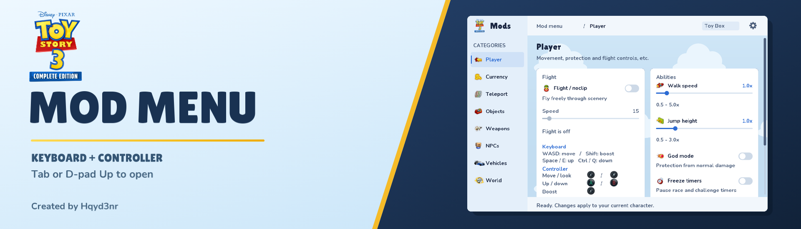
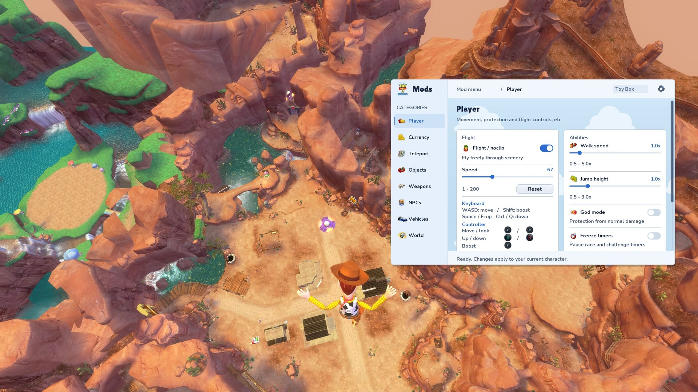

# Toy Story 3 Mod Menu

An in-game mod menu for **Toy Story 3 Complete Edition** on Windows (Steam), created by **Hqyd3nr**.

Press **Tab** or **D-pad Up** in a level to open it. It works with keyboard and mouse or a controller.

**Download:** [Releases](../../releases) · [Nexus Mods](https://www.nexusmods.com/toystory3completeedition/mods/27) · [GameBanana](https://gamebanana.com/mods/733634)

Early builds are posted to [Releases](../../releases) as pre-releases before they reach Nexus Mods and GameBanana.

## What's inside

- **Player** — Flight/noclip, adjustable flight speed, God mode, Walk speed and Jump height sliders, and Freeze timers for races and timed challenges. Transform into Zurg and back with Play as Zurg, switch between Woody, Buzz and Jessie in Toy Box, and turn on Buzz's laser.
- **Currency** — Add coins or Pixar Balls in Toy Box, then collect them and save normally to keep them.
- **Teleport** — Travel to Toy Box places: Town, Farm, Suburbs, Bandit Hideout, Sid's Haunted House, Enchanted Glen, Zurg's Spaceport, Stunt Park, Skate Park, Quarry and Stagecoach. Save up to six of your own points and return to them.
- **Objects** — Spawn every carriable object from the game, with categories and search.
- **Weapons** — Add and equip supported Toy Box weapons and tools without meeting their unlock requirements.
- **NPCs** — Spawn townspeople, aliens, fairies, bandits, gargoyles, Zurg robots, muffins and named characters from the game. Choose available outfits and enemy variants, or use random outfits.
- **Vehicles** — Summon the Sports Car, Teeny Racer, Bullseye, Zurg's Car and the Dragon, each with different styles.
- **World** — Change the sky to Western, Sid's Haunted House, Enchanted Glen or Zurg's Spaceport.

## Screenshot

More screenshots on [Nexus Mods](https://www.nexusmods.com/toystory3completeedition/mods/27?tab=images) and [GameBanana](https://gamebanana.com/mods/733634).

## Installation

1. In your Steam Library, right-click **Toy Story 3 Complete Edition** and choose **Manage > Browse local files**.
2. Extract the downloaded ZIP.
3. Copy `dinput8.dll`, `TS3ModMenu.dll` and the inner `Mod Menu` folder into the game folder, beside `Toy Story 3 Complete Edition.exe`.
4. Launch the game, load a level and press **Tab** or **D-pad Up** to open the menu. You can change the menu key or button in **Settings > Controls**.

Keep the folder structure and DLL names unchanged, and back up any files you replace. If another mod uses `dinput8.dll`, check compatibility before replacing it.

## Controls

- **Tab / D-pad Up** — open the menu
- **D-pad** — navigate
- **A** — select
- **B** — back / close
- **Tab / Escape** — close
- **Left stick** — adjust the selected slider
- **Right stick** — scroll

Controllers use XInput or Steam Input.

## Removal

Remove the supplied DLLs and restore any files you replaced. Keep your `Mod Menu/Backups` folder before removing the mod folder. Removing the mod will not undo currency, weapon or picture-disc changes saved in the game.

## Reporting problems

Found a bug? Open an [issue](../../issues) and include the version shown at the bottom of Settings, whether you play with keyboard or controller, and what happened.

Please attach `Mod Menu\Logs\Latest.log` from your game folder. Send it before you restart the game, because it's replaced each launch. If the game crashed, also attach the newest `.txt` file from `Mod Menu\CrashDumps`. These files stay on your PC; nothing is uploaded.

## Repository layout

| Folder | Contents |
| --- | --- |
| `src/menu` | Menu interface, settings, controller navigation, localization and the public `dinput8.dll` entry point |
| `src/renderer` | Native Direct3D renderer, shaders and renderer tests |
| `src/backend` | Game-side features: flight, teleport, characters, objects, vehicles, world and timers |
| `assets` | Menu icons, portraits, fonts, world signs and logo |
| `vendor` | Third-party headers and their licenses |
| `tools` | Build, test and asset scripts |

## Building

The mod builds as two 64-bit DLLs:

- `TS3ModMenu.dll`: the menu (`src/menu`, `src/renderer`)
- `dinput8.dll`: the game backend (`src/menu/PublicModMenu.cpp` with `src/backend` on the include path)

Requirements: MSVC 14.34 x64 (Visual Studio 2022 17.4), Windows SDK 10.0.22621 and Python 3. The asset scripts also need Pillow, and shader compilation uses DXC.

The scripts in `tools` were written for the author's own workspace: `<workspace>` and `<msvc-toolchain>` mark the paths to set for your machine. Release builds also encode internal strings and use extra hardening flags, so a local build will not be byte-identical to a release.

The menu targets Toy Story 3 **Complete Edition** only. Game addresses from the original Steam Toy Story 3 release are different.

## Team

- [Hqyd3nr](https://github.com/Hqyd3nr) — creator, feature direction, interface design and menu artwork.
- [RichiePlayz2593](https://github.com/RichiePlayz2593) — community support and beta testing.

## Credits

- Disney/Pixar and Avalanche Software — characters and game artwork.
- Toy Story 3 Companion — interface and typography inspiration.
- Lilita One by Juan Montoreano and Nunito by The Nunito Project Authors — fonts.

## License

Copyright (C) 2026 Hqyd3nr. Licensed under the [GNU General Public License v3.0](LICENSE): you may use, share and modify the mod, but anything you distribute that is based on it must keep the credit and be released under the same license with its source code. Game material and third-party components keep their own terms; see [NOTICE](NOTICE).

Unofficial fan-made mod; not endorsed by the game developers or publishers.
